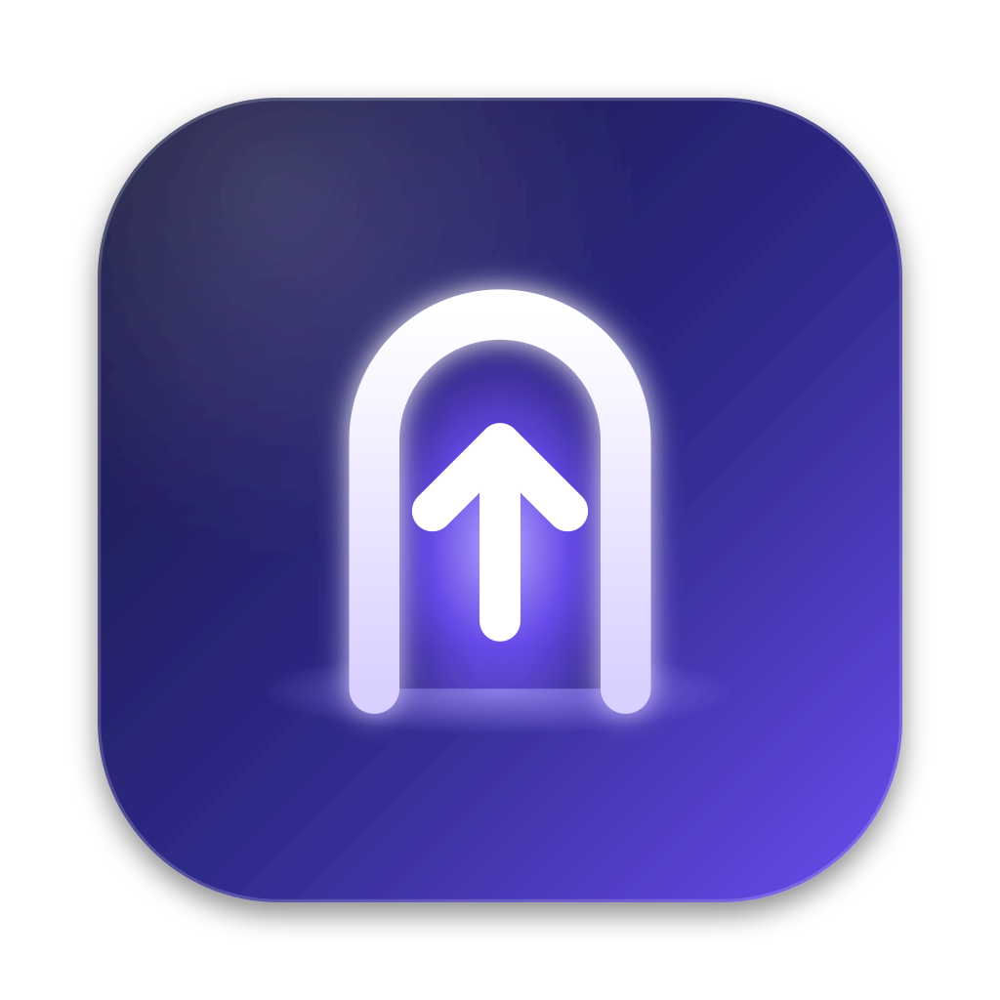
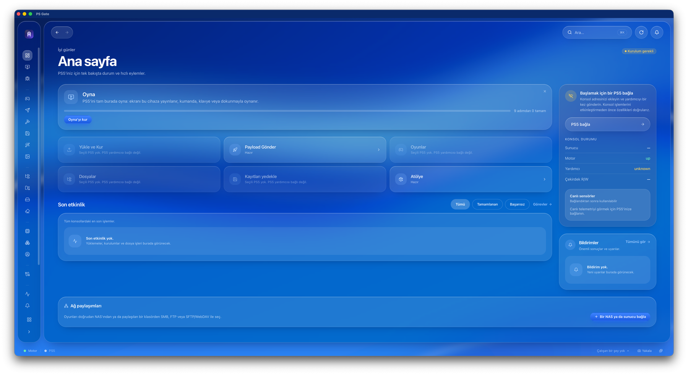
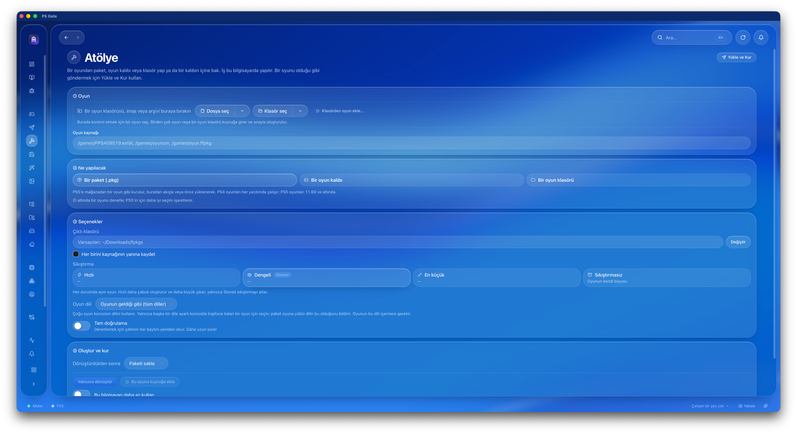
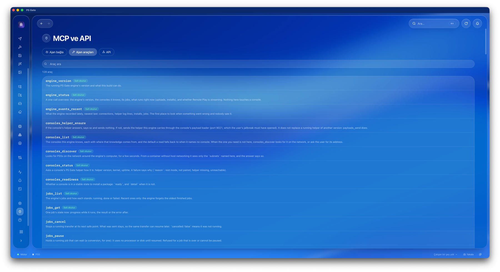
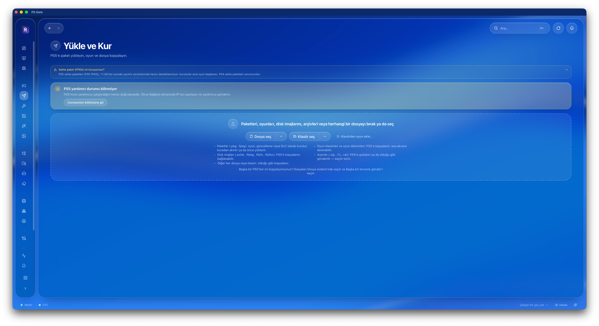
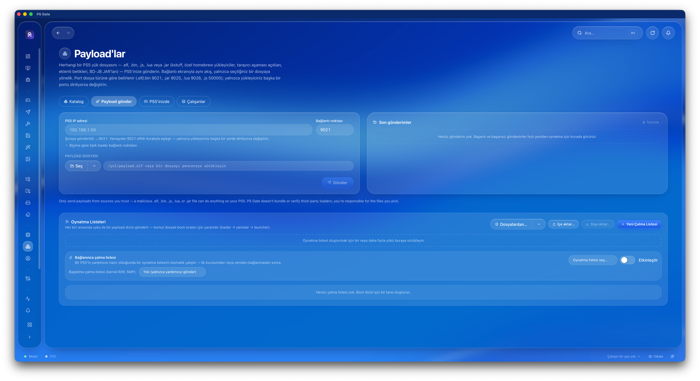

<p align="center">
  
</p>

<h1 align="center">PS Gate</h1>

<p align="center">
  Jailbreak'li PS5'iniz için macOS uygulaması: oyun, uygulama ve homebrew yükleyin, kurun, yönetin ve mac üzerinde oynayın.
</p>

<p align="center">
  
  
  
</p>
<p align="center">
  
</p>

<p align="center">
  <a href="#türkçe">Türkçe</a> · <a href="#english">English</a>
</p>

---

## Türkçe

PS Gate, jailbreak'li bir PS5'i Mac'ten yönetmek için bir macOS uygulamasıdır. Oyunları ve
paketleri PS5'e gönderir ve kurar; konsoldaki dosyaları, oyunları ve kayıtları yönetir; PS5'i Mac'ten
oynamanızı sağlar.

> **Önemli:** PS Gate yalnızca jailbreak'li bir PS5 ile çalışır ve Sony ile hiçbir bağlantısı yoktur.
> Kullanmadan önce [Yasal uyarı](#yasal-uyarı) bölümünü okuyun.

### Özellikler

- **Hızlı ve kesintiye dayanıklı aktarım.** Oyun klasörleri, disk imajları, paketler ve `.zip` / `.7z` /
  `.rar` arşivleri tek bir şifreli bağlantı üzerinden gönderilir. Bağlantı koparsa ya da PS5 dinlenme
  moduna geçerse aktarım kaldığı yerden devam eder; her dosya doğrulanır. Sıra, canlı hız ve kalan süre
  görünür; yer yetmeyecek bir iş baştan reddedilir.
- **Yükle ve Kur.** Tek bir bırakma alanı paketleri, oyun klasörlerini, disk imajlarını ve arşivleri
  tanır. PS4 `.pkg` ve PS5 sahte paketleri Mac'ten, ağ paylaşımından, USB sürücüden ya da bir
  bağlantıdan kurulabilir; bir yol işe yaramazsa uygulama başka bir yol önerir.
- **Oyunlar.** Bilgisayarınızdaki, ağ paylaşımlarınızdaki ve PS5'teki oyunlar tek bir ızgarada;
  güncellemeler ve DLC'ler oyunlarıyla birlikte. NAS'taki klasörler kopyalanmadan yerinde taranır.
  Kurulu bir oyun doğrudan kartından başlatılır ya da kapatılır; her oyunun sayfasından kurma,
  bağlama, ana ekrana ekleme, taşıma, yedekleme ve dönüştürme.
- **Atölye.** Oyunlarınızı bu bilgisayarda dönüştürür; iş Mac'te yapılır, sonra isterseniz PS5'e
  kurulur.
  - **Ne yapılacağını seçin:** kurulabilir bir **paket (`.pkg`)**: PS5'e mağazadan bir oyun gibi
    kurulur; PS4 oyunları her yazılımda, PS5 oyunları 11.60 ve altında çalışır. Ya da PS5'in
    bağlayabildiği bir **oyun kalıbı** (`.exfat`, `.ffpkg`, `.ffpfs`, `.ffpfsc`) ya da bir **oyun
    klasörü**. Uygulama, seçtiğiniz oyun ve PS5'iniz için hangisinin daha uygun olduğunu işaretler.
  - **Kaynak:** oyun klasörünü, imajı ya da arşivi sürükleyip bırakın, dosya veya klasör seçin ya
    da PS5'teki bir yolu yazın. Birden çok oyun ya da bütün bir oyun klasörü kuyruğa girer ve
    sırayla oluşturulur.
  - **Sıkıştırma:** Hızlı, Dengeli (önerilen), En küçük ya da Sıkıştırmasız; bir oyun seçince her
    seçeneğin tahmini boyutu görünür. Oyun her durumda aynıdır, yalnızca boyut ve süre değişir.
  - **Oyun dili:** başka bir dile ayarlı bir konsolda İngilizce açılan bir oyun için pakete dil
    bilgisi yazılabilir.
  - **Çıktı ve doğrulama:** çıktı klasörünü seçin ya da her birini kaynağının yanına kaydedin;
    **Tam doğrulama** çıktının her baytını yeniden okuyup denetler.
  - **Oluştur ve kur:** yalnızca dönüştürün ya da dönüştürüp hemen PS5'e kurun; kurduktan sonra
    paketi saklayın ya da silin. **Bu bilgisayarı daha az kullan** ile dönüştürme arka planda,
    Mac'i yormadan çalışır.
  - **İçine bakma ve düzenleme:** bir oyun imajının ya da paketin içine bakın, dosyaları Mac'e
    kaydedin ya da dosyaları değiştirip düzenlenmiş bir kopya yazın; açtığınız imaj hiç değişmez.
- **Dosyalar ve konsol.** PS5'teki dosyalara göz atma, kopyalama, taşıma, silme, izin ayarlama; ekran
  görüntüleri ve video klipler; oyun kaydetme, başlatma, durdurma ve kaldırma.
- **Kayıt verileri.** Otomatik yedekler, tek tıkla yedekleme ve geri yükleme, başka bir kullanıcıya
  kopyalama. PS1, PS2 ve Switch emülatör kayıtları da yedeklenir.
- **Oyna.** PS5'i Mac'ten oynayın: dinlenme modundaki konsolu uyandırır ve kullanıcınızla oturum açar.
  Oyun kumandası, klavye veya fare; 1080p/720p, 60/30 fps; resim içinde resim. **Birlikte Oyna** ile
  arkadaşlarınız bir bağlantı ya da QR kod ile oyununuza 2., 3. ve 4. oyuncu olarak katılır. Oyunu
  YouTube, Twitch ve diğer RTMP/SRT sunucularına canlı yayınlayabilirsiniz.
- **Paylaşılan Klasörler.** NAS'ınızı ya da sunucunuzu SMB, FTP veya SFTP/WebDAV ile bağlayın;
  oyunlar doğrudan oradan seçilir ve kurulur.
- **Birimler.** PS5'in depolama sürücüleri ve şu anda bağlı disk imajları.
- **Temizlik.** PS5'in sürücülerini dolduran ve güvenle silinebilecek dosyaları bulur: güncellemeler,
  geride kalan paket dosyaları, geçici dosyalar ve kaldırılmış oyunların artıkları. Siz seçip
  onaylamadan hiçbir şey silinmez.
- **Hileler.** Bir oyun seçin, sürümüne uygun hileleri indirin ve oynarken açıp kapatın.
- **Konsol.** Çalışan işlemler, donanım ve sıcaklıklar, fan eğrisi, çekirdek günlüğü ve PS5 üzerinde
  komut çalıştırmak için bir **Shell**.
- **Payload'lar.** Payload ELF'lerini katalogdan ya da kendi dosyalarınızdan, tek tek veya bir oynatma
  listesi olarak konsolun yükleyicisine gönderin. Geriye taşınmış oyunlar için uyumluluk ayarı da
  buradadır.
- **Hesaplar.** Konsolun kullanıcı hesapları: adlarını değiştirin, bir hesaba kimliğini verin,
  avatarları değiştirin ve Oyna'yı kurun.
- **Birden çok cihaz, tek PS5.** Bilgisayarlar, telefonlar ve Docker kurulumları aynı anda eşleştirme
  kodu olmadan bağlanır; **Cihazlar** ekranında kimin ne yaptığı görünür. Konsollar ve ayarlar
  paylaşılır ve her gün hem motora hem konsola yedeklenir. **Mesh Drive** bir klasörü bütün
  cihazlarda aynı tutar.
- **Etkinlik, günlükler ve bildirimler.** Bütün yüklemeler, kurulumlar ve dosya işleri tek bir
  listede; önemli sonuçlar ve uyarılar bildirim olarak gelir.
- **Güç.** Dinlenme modu, yeniden başlatma, kapatma ve ağ üzerinden uyandırma.
- **PS Gate Minion.** PS5'in kendi tarayıcısında açılan, kumandayla kullanılan bir sayfa: kurulu
  oyunlar, kayıt yedekleri, dosyalar, hileler ve ayarlar; yanınızda bilgisayar olmadan.
- **Hata bildirimi.** Uygulamanın, motorun ve PS5 yardımcısının günlüklerini tek bir `.zip`'te
  toplar; adresler, seri numaraları ve anahtarlar çıkarılır.
- **MCP ve API: yapay zekâ ajanlarıyla yönetim.** PS Gate'in motoru `http://127.0.0.1:19113/mcp`
  adresinde bir MCP sunucusu çalıştırır; Claude Code, Codex veya OpenCode gibi bir yapay zekâ ajanı
  PS5'i anladığı araçlarla yönetebilir: dosya gönderme, oyun yükleme, sıcaklık kontrolü ve daha
  fazlası. Bir kez ekleyin, sonra yalnızca isteyin.
  - **Ajan bağla:** Claude Code'a tek tıkla ekleme; Codex ve OpenCode için hazır terminal
    komutları ve bağlantıyı doğrulama komutları (`mcp list`). Uygulama ajanın bu bilgisayarda
    kurulu ve ekli olup olmadığını gösterir; kurulu değilse indirme bağlantısını verir.
  - **Ajan araçları:** ajanın kullanabileceği 128 aracın aranabilir listesi: motor durumu,
    konsolları bulma, yardımcıyı gönderme, işleri başlatma, duraklatma ve iptal etme ve daha
    fazlası. Yalnızca okuyan araçlar **Salt okunur** olarak işaretlidir.
  - **API:** betikler için aynı motorun HTTP API'si ve OpenAPI belgesi.
  - **Kendiliğinden güncel:** ajanlar araçlarını motordan alır; PS Gate güncellendiğinde yeni
    araçlar ajanın bir sonraki oturumunda görünür. Motorun adresi değişirse uygulama bunu söyler ve
    tek tıkla düzeltir. Gemini CLI, Cursor, Claude Desktop ve kendi betikleriniz için kurulum
    bilgisi de ekranda.
  - **Örnek istekler:** "PS5'im şu anda ne kadar sıcak?", "PS5'imde en çok yeri ne kaplıyor?",
    "Bu paketi PS5'ime yükle ve bitince bana haber ver."

### Ekran görüntüleri

<table>
  <tr>
    <td width="50%"></td>
    <td width="50%"></td>
  </tr>
  <tr>
    <td align="center"><b>Atölye</b>: paket, oyun kalıbı ya da oyun klasörü oluşturma</td>
    <td align="center"><b>MCP ve API</b>: ajan araçları</td>
  </tr>
  <tr>
    <td width="50%"></td>
    <td width="50%"></td>
  </tr>
  <tr>
    <td align="center"><b>Yükle ve Kur</b>: paket, oyun ve dosya gönderme</td>
    <td align="center"><b>Payload'lar</b>: payload gönderme ve oynatma listeleri</td>
  </tr>
</table>

### Gereksinimler

- **Mac:** Apple Silicon (M1 ve sonrası) bir Mac, macOS 11 (Big Sur) veya daha yenisi.
- **PS5:** Jailbreak'li bir PS5 ve çalışan bir ELF yükleyici (port 9021). Sahte paketleri kurmak ve
  çalıştırmak için kstuff gerekir.
- **Ağ:** Mac ve PS5 aynı yerel ağda olmalı.

### İndirme ve kurulum

1. **[PS Gate'i indirin (Apple Silicon Mac, .dmg)](https://github.com/0xxnr/ps-gate/releases/latest/download/PS-Gate-mac-arm64.dmg)**. Tüm sürümler
   [Releases](https://github.com/0xxnr/ps-gate/releases) sayfasında.
2. `.dmg` dosyasını açın ve **PS Gate**'i **Applications** (Uygulamalar) klasörüne sürükleyin.
3. Uygulama ücretli bir Apple sertifikasıyla imzalı değildir; bu yüzden macOS ilk açılışta "hasarlı"
   ya da "açılamıyor" diyebilir. Açmadan önce Terminal'de bir kez şunu çalıştırın:

   ```bash
   xattr -dr com.apple.quarantine "/Applications/PS Gate.app"
   ```

4. PS Gate'i açın. macOS yerel ağ izni istediğinde, PS5'i bulabilmesi için **İzin Ver** deyin.

### İlk kullanım

1. PS5'te jailbreak'i çalıştırın ve ELF yükleyicinin açık olduğundan emin olun.
2. PS Gate'i açın ve sol üstteki **PS5 eklenmedi — eklemek için tıkla** kutusundan ya da
   **Bağlantı** ekranından PS5'inizin IP adresini girin.
3. **Bağlantı** ekranındaki **PS Gate yardımcısını PS5'inize gönderin** adımını tamamlayın.
   Yardımcı, uygulamanın konsolla konuştuğu küçük bir programdır; konsol yeniden başladığında
   tekrar gönderilmesi gerekir.
4. Artık **Yükle ve Kur**, **Oyunlar**, **Dosyalar** ve **Oyna** ekranlarını kullanabilirsiniz.

Sık sorulan sorular uygulamanın **Yardım** ekranında.

### API, yapay zekâ asistanları ve otomasyon

PS Gate'in motoru Mac'te `http://127.0.0.1:19113` adresinde bir HTTP API ve bir MCP sunucusu
çalıştırır; betikler ve yapay zekâ asistanları (Claude, Codex, OpenCode, Gemini) PS5'i bunlar
üzerinden yönetebilir. Uygulamadaki **MCP ve API** ekranı kurulum komutlarını, araç listesini
ve API belgesini hazır verir.

### Katkı

Hata bildirimleri ve öneriler için [Issues](https://github.com/0xxnr/ps-gate/issues) sayfasını
kullanın. Uygulamadaki **Hata bildirimi** ekranı, bildirime eklenecek günlükleri hazırlar.

### Lisans

PS Gate, **GNU General Public License v3.0** ile lisanslıdır; tam metin [`LICENSE`](LICENSE)
dosyasında. Bu uygulama, açık kaynak bir çalışmanın değiştirilmiş sürümüdür; telif ve değişiklik
bildirimleri [`NOTICE.md`](NOTICE.md) dosyasında.

Lisans gereği, yayınlanan her sürümün kaynak kodu o sürümün [Releases](https://github.com/0xxnr/ps-gate/releases/latest) sayfasında
`PS-Gate-<sürüm>-kaynak.zip` dosyası olarak indirilebilir; üçüncü taraf lisansları bu arşivdeki
`LICENSES/` klasöründedir.

### Yasal uyarı

PS Gate araştırma, eğitim, birlikte çalışabilirlik ve homebrew geliştirme amaçlıdır. Sony Interactive
Entertainment ile bağlantılı değildir ve onlar tarafından onaylanmamıştır. "PlayStation" ve "PS5",
Sony Interactive Entertainment Inc.'in ticari markalarıdır. Değiştirilmiş bir konsol kullanmak
konsola zarar verebilir, kayıtları silebilir ve hesabınızın yasaklanmasına yol açabilir; tüm risk
size aittir. Yalnızca sahip olduğunuz donanım ve yasal olarak sahip olduğunuz içerikle kullanın.
Ayrıntılar: [`DISCLAIMER.md`](DISCLAIMER.md).

---

## English

PS Gate is a native macOS app for managing a jailbroken PS5 from your Mac: send and install games
and packages, browse and manage the console's files, games and saves, and play the PS5 remotely.
The interface is available in 21 languages.

**Highlights:** resumable, verified transfers over one encrypted connection · Upload & Install for
packages, game folders, disk images and archives · one Games grid for your folders, network shares
and the console · Workshop to build packages and mountable images · save backups and restore ·
remote play with Play Together and live streaming · cheats, fan curve, payload sender · PS Gate
Minion, a controller-friendly page in the PS5's own browser · Workshop options (package, game
image or folder; four compression levels; game language; full verification; convert-and-install
queue; look inside and edit images) · Shared Folders (SMB, FTP, SFTP/WebDAV), Volumes and Clean Up ·
Accounts · console processes, hardware, fan curve, kernel log and a Shell · several devices on one
PS5 with Mesh Drive · activity, logs and notifications · an MCP server
(`http://127.0.0.1:19113/mcp`) so AI agents such as Claude Code, Codex and OpenCode can manage the
PS5 (one-click add for Claude Code, ready-made commands for the others, a searchable list of 128
tools and the HTTP API).

**Requirements:** a Mac with Apple Silicon and macOS 11 or later; a jailbroken PS5 with an ELF loader
(port 9021), and kstuff for fake packages; both on the same local network.

**API & MCP:** the engine serves an HTTP API and an MCP server at `http://127.0.0.1:19113` for
scripts and AI agents; the app's **MCP & API** screen gives the setup commands, tool list and API docs.

**Download:** [PS Gate for Apple Silicon Macs (.dmg)](https://github.com/0xxnr/ps-gate/releases/latest/download/PS-Gate-mac-arm64.dmg) · all versions on the
[Releases](https://github.com/0xxnr/ps-gate/releases) page. Open the `.dmg`, drag **PS Gate** into
**Applications**, then run `xattr -dr com.apple.quarantine "/Applications/PS Gate.app"` once.

**License:** GPL-3.0 (see [`LICENSE`](LICENSE)). PS Gate is a modified version of an open-source
work; copyright and modification notices are in [`NOTICE.md`](NOTICE.md). As the license requires,
each release's source code is attached to it on the [Releases](https://github.com/0xxnr/ps-gate/releases/latest) page as
`PS-Gate-<version>-kaynak.zip`.

**Disclaimer:** for research, education, interoperability and homebrew development only. Not
affiliated with or endorsed by Sony Interactive Entertainment. Use at your own risk, only with
hardware and content you own. See [`DISCLAIMER.md`](DISCLAIMER.md).
